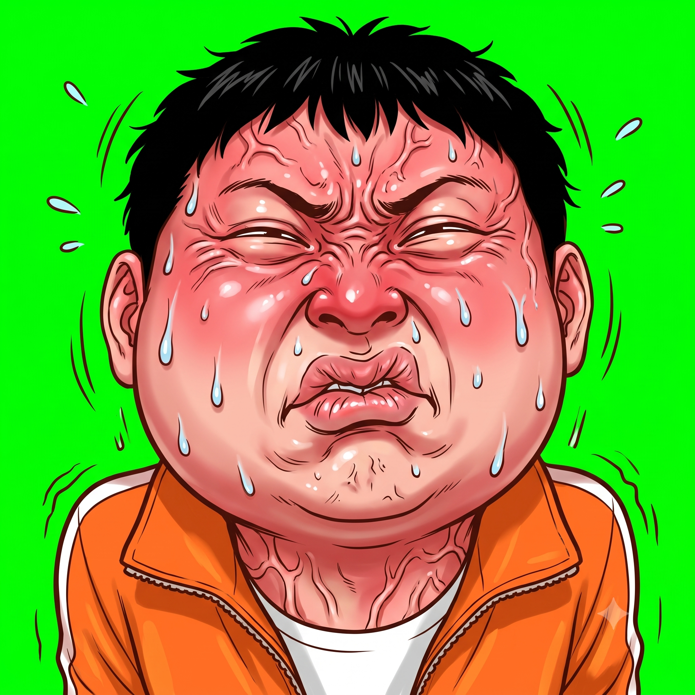
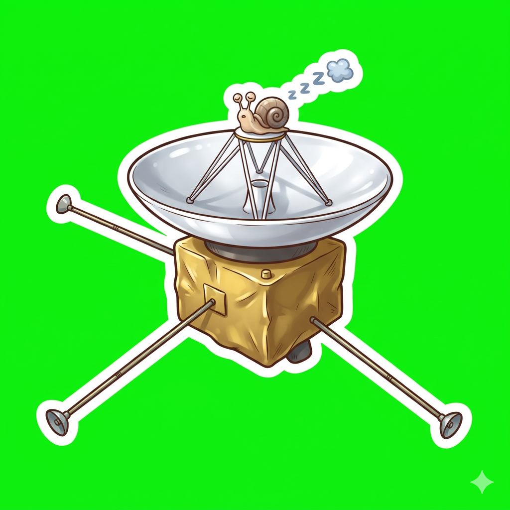
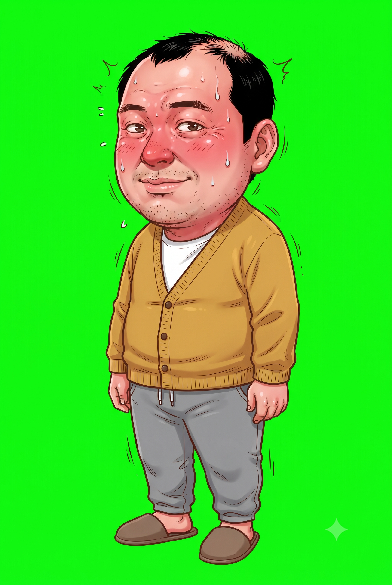
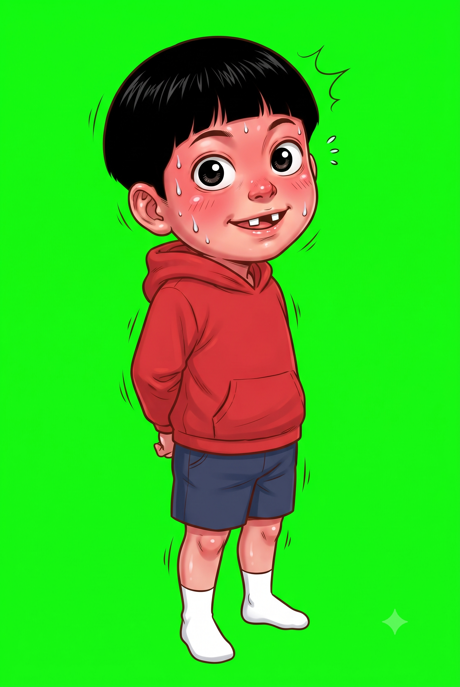
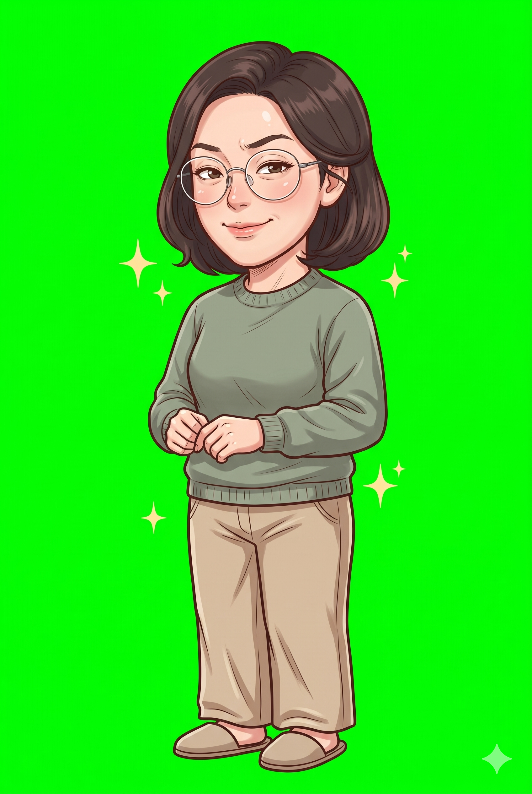

# 모라구 그림 가이드 — 항상 기준 그림을 보고, 같은 화풍으로

모라구 채널(qna · 모답맨 · 내모남불)의 모든 AI 그림은 이 문서대로 만든다.
새 편 · 새 시리즈 · 새 인물이어도 같다. 사람이 하든 Claude 가 하든, 크롬 Gemini 든 `artgen`(API)이든 같다.

> **한 줄 원칙: 글자 프롬프트만으로 그리지 않는다. 모든 그림은 기준 그림을 첨부해서, 정해진 순서대로 그린다.**
> 첨부 목록은 사람이 고르지 않는다. 코드(`video/scripts/art-lib.mjs` 의 `attachPlan`)가 정하고, 사람은 그 목록을 빠짐없이 올린다.

왜 이렇게까지 하나 — 실제로 있었던 일:

| 언제 | 무슨 일 | 그래서 생긴 규칙 |
|---|---|---|
| 9화 (10-24) | 시그니처 포즈를 기준 그림 없이 글자로만 뽑았더니 아빠 · 엄마 얼굴이 딴사람이 됐다 | 사람이 나오면 그 사람 `normal.png` 를 항상 붙인다 |
| 10화 (10-25) | 소품에 얼굴 앵커만 붙였더니 앵커 속 주황 점퍼 아저씨 위에 물건을 덧그렸다 | 사람 없는 소품은 소품 앵커를 붙인다 |
| 10-25 | 여럿 나오는 장면 · 상상 장면 · 이어 그리는 컷에서 첨부를 빼먹어 그림체가 또 바뀌었다 | 장면 속 사람 전원 · 이어 그리는 컷의 앞 컷까지 코드가 자동으로 붙인다 |

---

## 1. 화풍 — 모라구 그림은 이렇게 생겼다

| 항목 | 기준 |
|---|---|
| 장르 | 일본 개그 만화 스티커 일러스트. 표정은 **징그러울 만큼 과장** (크게 벌린 입 · 이와 잇몸 · 튀어나온 눈 · 땀방울 · 주름) |
| 칠 | 반사실적 에어브러시 피부 명암 + 반짝이는 하이라이트, 채도 높은 색, 깔끔한 가장자리 |
| 선 | 가는 갈색-검정 잉크 선 |
| 몸 | 큰 머리, 짧고 통통한 몸 (약 2.5등신) |
| 사람 · 장소 | 한국 사람 · 한국 배경 (따로 적지 않으면) |
| 글자 | **그림에 글자를 넣지 않는다** — 간판 · 명찰 · 화면은 빈칸. 자막 · 연도 · 간판 글씨는 영상 코드가 얹는다. 로고 · 국기 · 워터마크도 없음 |
| 배경 | 오려 쓰는 그림(인물 · 컷인 · 소품)은 **단색 초록 #00FF00**. 배경 · 장면 그림은 16:9 완성 그림 |
| 방향 | 아빠 · 엄마는 화면 **왼쪽을 보고**(3/4 view LEFT), 아이는 **오른쪽을 본다**(RIGHT) → 화면에서 마주 본다. 손님은 서는 자리의 반대쪽(대화 상대 쪽)을 본다 |

이 화풍 문장은 `video/scripts/prompts.mjs` 의 `STYLE` (사람 그림) · `PROP_STYLE` (사람 없는 소품) 에 들어 있고 **모든 프롬프트 맨 앞에 자동으로 붙는다.** 화풍을 바꾸고 싶으면 거기 한 곳만 고친다 — 편마다 따로 적지 않는다.

## 2. 기준 그림 지도 — 무엇을 보고 그리나

| 역할 | 파일 | 언제 붙나 |
|---|---|---|
| **화풍 앵커** (사람 그림) | `art/anchor/style-cutin.png` | 사람이 나오는 모든 그림의 ① |
| **소품 앵커** | `art/anchor/style-prop.png` (10화 우주 탐사선, 1024px) | 사람 없는 소품 · 앞쪽 레이어의 ① |
| 아빠 기준 | `art/common/dad/normal.png` | 아빠가 나오는 모든 그림 |
| 아이 기준 | `art/common/kid/normal.png` | 아이가 나오는 모든 그림 |
| 엄마 기준 | `art/common/mom/normal.png` | 엄마가 나오는 모든 그림 |
| 가족 대표 컷인 (얼굴 · 피부 톤) | `art/common/cutin/dad-shock.png` · `kid-ask.png` · `mom-smirk.png` | 그 사람의 가슴 위 컷인 |
| 시그니처 첫 프레임 | `art/common/cutin/dad-sig-1.png` · `mom-sig-1.png` | 시그니처 2~N 컷 |
| 손님 기준 | `episodes/NN-…/art/<손님>/normal.png` (그 편에서 먼저 뽑는다) | 그 손님이 나오는 모든 그림 |
| 공통 배경 | `art/common/bg/living-room.png` 등 | 같은 장소를 다른 시간 · 조명으로 그릴 때 `attach` 로 |

<p>





</p>

가족의 생김새 글(영어)은 `video/src/art-common.json` 의 `cast`, 대표 컷인은 `refs` 에 있다. 기준 그림을 바꾸면 그 뒤 모든 그림이 바뀌므로 **기준 그림은 고치지 않는다** (꼭 바꿔야 하면 옛 그림을 `_old/` 로 옮기고, 사용자에게 먼저 묻는다).

## 3. 첨부 규칙 — 코드가 자동으로 정한다

`npm run prompts -- <편>` 을 돌리면 그림마다 첨부 목록이 정해져 `GEMINI_PROMPTS.md` (`- 첨부 N장 (빠짐없이, 이 순서로)`) 와 `jobs/images.json` (`attach`) 에 들어간다. 순서는 이렇다:

| 순서 | 무엇 | 규칙 |
|---|---|---|
| ① | 앵커 | 사람이 나오면 화풍 앵커, 사람 없는 소품(`prop` · `layer`)이면 소품 앵커 |
| ② | `ref` | 그 사람의 `normal` (가족 = 공통, 손님 = 그 편). 말하는 그림 · 이어 그리는 컷이면 첫 프레임. 기준 그림 자신(`…/normal`)은 `ref: null` |
| ③… | `attach` | art.json 에 직접 적은 것 (같은 방의 다른 시간 · 채널 프로필 등). 설명문이 "attached image 3" 처럼 번호로 부르므로 순서를 바꾸지 않는다 |
| 그 뒤 | 자동 | 이어 그리는 컷 → 그 사람 `normal` + 바로 앞 컷 · 가족 컷인 → 대표 컷인 · `people` 에 적은 사람마다 → 그 사람 `normal` |

프롬프트에도 "Attached image 3 shows the mom: …" 처럼 **몇 번째 그림이 누구인지** 자동으로 들어간다.

### 경고 ⚠️ 와 멈춤 ⛔
- 설명문(`desc`)에 dad · mom · kid · family 나 손님 이름(cast 의 `the docent:` 머리말)이 나오는데 그 사람 기준 그림이 첨부에 없으면, 블록에 **⚠️** 가 찍히고 `artgen` · `artrefs` 는 그 그림을 **만들지 않는다(⛔)**. art.json 에 `"people": [...]` 를 넣어 고친다.
- 첨부할 그림이 아직 없으면(손님 `normal` 을 아직 안 뽑음 등) 역시 ⚠️ — 그 그림부터 뽑는다.
- 사람이 정말 없는데 단어 때문에 걸리면(예: "child-size chair") `"people": []` 로 "확인했음"을 적는다.
- **⚠️ 가 하나라도 남아 있으면 그림을 뽑지 않는다.**

## 4. art.json 쓰는 법

```jsonc
{
  "title": "11화 — …",
  "cast": {
    // 손님 생김새: 반드시 "the <역할>: " 로 시작한다 (코드가 이 머리말로 사람을 알아본다)
    "chef": "the restaurant chef: a Korean man in his fifties, …; NO text, NO logos"
  },
  "common": ["common/dad/normal", "common/cutin/dad-sig-1"],   // 이 편이 쓰는 공통 그림
  "items": [
    { "id": "chef/normal", "kind": "char", "who": "chef", "ref": null, "title": "요리사 — 기본",
      "desc": "3/4 view turned slightly to the RIGHT. Standing upright, …" },
    { "id": "chef/correct", "kind": "char", "who": "chef", "title": "요리사 — 정정",
      "desc": "3/4 view turned slightly to the RIGHT. One finger raised, …" },          // ref 는 자동으로 chef/normal
    { "id": "full/kitchen-chaos", "kind": "full", "people": ["dad", "kid", "chef"], "title": "장면 — 주방 난리",
      "desc": "… the dad … the kid … the chef …" },                                      // 셋 다 normal 자동 첨부
    { "id": "prop/knife-set", "kind": "prop", "title": "소품 — 칼 세트",
      "desc": "A set of kitchen knives on a magnetic strip, …" }                         // 소품 앵커 자동
  ]
}
```

| 필드 | 뜻 |
|---|---|
| `id` | 저장 경로가 된다. `bg/…` 배경, `full/…` 한 장 장면, `<인물>/…` 전신, `cutin/…` 가슴 위, `prop/…` 소품 |
| `kind` | `char` 전신 2:3 · `cutin` 가슴 위 1:1 · `prop` 소품 · `bg` 배경 16:9 · `full` 완성 장면 16:9 · `stage` 주인공 뺀 무대 · `talk` 말하는 두 번째 프레임 · `layer` 앞쪽 가림막 |
| `who` | 주인공 한 명 (가족 `dad` · `kid` · `mom` 또는 `cast` 의 키). 생김새 글과 `normal` 이 자동으로 들어간다 |
| `people` | `who` 말고 **같이 나오는 사람 전부**. 장면 · 상상 · 소품 속 인물까지. 사람이 없으면 `[]` |
| `ref` | 기본값이 맞지 않을 때만 (첫 프레임, 다른 표정을 기준으로). 기준 그림 자신은 `null` |
| `attach` | 기본 규칙에 없는 추가 그림 `[{ "path": "art/common/bg/living-room.png", "label": "같은 거실" }]` |
| `desc` | **영어로**, 포즈 · 표정 · 소품만. 옷 · 얼굴은 cast 와 기준 그림이 맡으므로 다시 쓰지 않는다. 방향(LEFT/RIGHT)을 첫 문장에 |

## 5. 뽑는 순서

명령은 `qna/video` 에서.

1. **목록** — `npm run prompts -- epNN` → `GEMINI_PROMPTS.md` 에 ⚠️ 가 없는지 본다. 있으면 art.json 을 고치고 다시.
2. **기준부터** — 새 손님은 `<손님>/normal` 을 **먼저** 뽑아 사용자에게 보여 주고 확정한 뒤 나머지를 뽑는다. 시그니처 · 말하는 그림도 첫 프레임부터.
3. **첨부 준비** — `npm run artrefs -- epNN` → `video/out/refs/epNN/<번호>-<id>/` 에 그림마다 첨부 사본(1024px)이 **순서 번호가 붙어** 준비된다. ⛔ 가 찍힌 그림은 보내지 않는다.
4. **생성** — 둘 중 하나:
   - **크롬 Gemini (무료)**: 새 채팅 → 업로드 및 도구 → 이미지 만들기 · 비율 → 그 그림 폴더의 파일을 **번호 순서대로 전부** 첨부 → 프롬프트 블록 붙여넣기 → 보내기. 한 사람은 한 대화창에서 끝내고, 다음 사람 · 배경은 새 대화창. 첨부가 하나라도 실패하면 글자만 보내지 않는다. 자동 큐로 여러 장 돌릴 때는 보내기 전에 항목마다 첨부 수를 출력해 `attach` 길이와 같은지 확인한다. (크롬 조작 세부: 메모리 `qna-chrome-gen` · `qna-art-reference-rule`)
   - **API (유료)**: `npm run artgen -- epNN` — **사용자가 "API 로 만들어 줘" 할 때만.** 첨부는 jobs 목록 그대로 자동으로 붙는다. 먼저 `--list` 로 목록만 본다.
5. **저장** — Gemini 원본을 `GEMINI_PROMPTS.md` 의 **저장** 경로 이름 그대로. 자르기 · 배경 지우기 · 크기 조절은 하지 않는다.
6. **비교 확인** — `npm run artreview -- epNN` → `jobs/review.html` 을 열어 결과를 첨부했던 기준 그림과 나란히 본다. 얼굴 · 머리 · 옷 · 피부 톤 · 선 굵기 · 과장 정도가 같은지. 판정은 `jobs/review.json` 에 `{"id": "ok"}` / `{"id": "redo: 엄마 안경이 사각"}`. 다르면 쓰지 않고 다시 뽑는다 (`--todo` 로 남은 것만 다시 본다).
7. **처리** — `npm run art -- epNN` (초록 배경 제거 · webp) → 샷 계획으로.

## 6. 다시 뽑을 때 이어서 보내는 문장

| 문제 | 문장 |
|---|---|
| 다른 사람처럼 나옴 | `Keep the exact same face, hair and clothes as attached image 2. Only change the pose.` |
| 화풍이 순해짐 | `More grotesque gag-manga exaggeration, like the first attached image: bigger mouth, bulging eyes, more sweat.` |
| 첨부 그림을 고쳐 버림 (소품 · 배경) | `Do not edit the attached image. Draw a completely new picture in the same style.` |
| 배경이 단색 초록이 아님 | `Redo it with a perfectly flat pure green #00FF00 background, no shadow, no floor.` |
| 몸이 잘림 | `Zoom out so the whole body fits with empty margin on every side.` |
| 글자가 들어감 | `Remove all text and letters; leave signs blank.` |
| 말하는 그림의 몸이 달라짐 | `Too different. Copy attached image 2 exactly and change only the mouth.` |
| 배경에 사람이 있음 | `Remove every person. Background only.` |

다시 보낼 때도 **첨부를 다시 붙인다** — 같은 대화라도 앞 그림 기억에만 기대면 컷이 갈수록 얼굴 · 색이 변한다.

## 7. 체크리스트 (그림 작업 끝낼 때)

- [ ] `GEMINI_PROMPTS.md` 에 ⚠️ 없음, `artrefs` 에 ⛔ 없음
- [ ] 새 손님은 `normal` 을 먼저 뽑고 확정했다
- [ ] 모든 그림을 첨부 N장 전부 붙여 뽑았다 (글자만 보낸 그림 없음)
- [ ] `artreview` 로 기준 그림과 나란히 비교했고, `review.json` 에 전부 ok
- [ ] 그림에 글자 · 로고 · 국기 없음, 오려 쓰는 그림은 단색 초록 배경
- [ ] 버린 그림은 지우지 않고 `_old/` 로 옮겼다

## 8. 범위

- 모답맨 본편(`ep…`) · 리메이크(`ep01f` · `ep08f`) · 내모남불(`nm…`) 모두 같은 가족 · 같은 앵커 · 같은 규칙.
- 1~8편 롱폼 그림은 이 규칙 전에 만든 것이라 ⚠️ 가 남아 있을 수 있다 — 이미 만든 그림은 그대로 두고, 다시 뽑을 때만 고친다.
- 모라구의 수학 · 과학 카테고리(`lab/`)는 AI 그림 없이 코드(Motion Canvas)로 그린다 — 이 문서 대상이 아니다.
