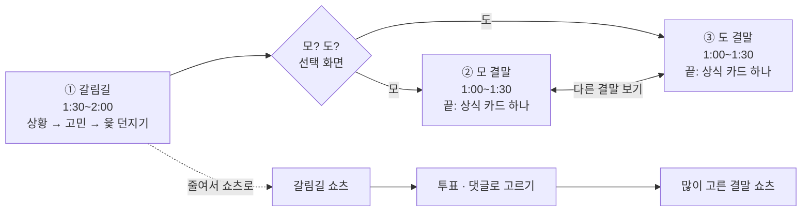

# 모 아니면 도 — 모라구 시리즈 기획

> 모라구 다섯 번째 카테고리 · 기획 시작 2026-10-29 · 1편 「캠핑 vs 집콕」 공개 (갈림길 https://youtu.be/oNgcci_fMTg · 모 결말 https://youtu.be/uxlwww6FWhE · 도 결말 https://youtu.be/kx0femiFoDM, 재생목록 「모 아니면 도 · 네가 고르는 우리 집 결말」)
> 같은 내용의 온라인 문서(그림 포함): https://claude.ai/artifact/DrejH1vQEfPmPUFGBhVLEv

## 한 줄 컨셉

아빠가 일상의 갈림길에서 윷을 던지고, **시청자가 모 · 도 중 하나를 골라 결말이 바뀌는** 인터랙티브 시트콤이다. 모라구 채널의 다섯 번째 카테고리로 기획한다.

- 아빠가 살까 말까 · 누를까 말까 · 말할까 말까 앞에서 멈추면 화면이 얼고, 3D 윷가락이 날아오르며 "모 아니면 도!"
- 두 결말 모두 웃기고, 끝에는 그 선택 뒤의 **생활 상식 · 심리 · 안전 지식 하나**가 남는다.
- 이름: 모 씨네 가족과 윷놀이 말(모 · 도)을 겹친 말장난. 원래 뜻(다 걸거나 다 잃거나)도 갈림길 이야기와 맞는다.
- 참고한 옛 형식은 1990년대 「TV 인생극장」("그래, 결심했어!")의 두 갈래 결말이다. 형식만 빌리고 이름 · 대사 · 장면은 따라 하지 않는다.

## 식구 역할

가족 셋은 다른 모라구 시리즈와 같은 그림 · 목소리를 쓴다 (아빠 · 나레이션 Algenib, 엄마 Kore, 모라구 Leda).

| 식구 | 이 시리즈에서 | 말버릇 |
| --- | --- | --- |
| 아빠 | 갈림길 앞에서 늘 망설이다 윷을 던진다 | "모 아니면 도!" |
| 엄마 | 두 결말을 다 보고 한 줄로 정리한다 | "둘 다 아니면?" |
| 모라구 | 시청자 대신 고르라고 외친다 | "아빠, 모! 모!" |

## 구조

한 편은 **갈림길 하나와 결말 둘**로 이루어지고, 두 결말은 같은 장면에서 갈라져 같은 장소 · 인물로 끝난다.

가로 영상은 갈림길에서 골라 한 결말로 가고, 결말 끝에서 다른 결말로 건너간다. 쇼츠는 갈림길을 줄여 올리고, 투표로 많이 고른 결말을 다음 날 올린다. 두 결말 모두 웃기고, 한쪽이 "벌"이 되지 않게 한다.

## 유튜브에서 고르게 하는 법

추천은 **가로 영상 3편(갈림길 · 모 결말 · 도 결말)을 최종 화면으로 잇고, 쇼츠로 투표를 부르는** 조합이다. 반응을 보고 한 편 묶음(챕터)과 비교한다.

| 방법 | 어떻게 | 장점 | 한계 |
| --- | --- | --- | --- |
| 최종 화면 (엔드스크린) | 갈림길 영상 끝에 모 결말 · 도 결말 영상을 왼쪽 · 오른쪽에 건다 | 누르면 바로 그 결말로 간다 — 가장 인터랙티브 | 마지막 5~20초에만 뜬다, 쇼츠에는 없다 |
| 챕터 · 타임스탬프 | 한 영상에 셋을 다 넣고 설명란 · 고정 댓글에 "모 → 2:05 / 도 → 3:20" | 한 편이라 시청 시간에 유리 | 누르는 수고가 한 번 더 |
| 쇼츠 + 투표 | 갈림길 쇼츠 → 커뮤니티 투표 · 댓글 → 많이 고른 결말을 다음 날 쇼츠로 | 참여 · 댓글이 늘고 다음 편을 기다리게 한다 | 결말을 바로 못 본다 |

- 최종 화면이 얹힐 자리를 비워 두도록, 선택 화면을 **왼쪽 반 · 오른쪽 반 빈 액자**로 디자인한다.
- 최종 화면 · 투표의 세부 조건(최소 길이, 아동용 영상 제한 등)은 업로드 전에 YouTube 고객센터로 다시 확인한다.

## 편 아이템

먼저 만들 두 편은 **스미싱 문자**(쓸모가 크고 두 결말 차이가 분명)와 **마트 1+1**(그림 재사용이 쉽다)이다.

| 갈림길 | 모 결말 | 도 결말 | 남는 지식 | 먼저 |
| --- | --- | --- | --- | --- |
| "오늘만 70%!" 문자 속 링크 | 누른다 → 앱 설치 · 개인정보 요구 | 안 누르고 공식 앱에서 확인 | 스미싱 구별법 · 신고 (공식 자료로 확인) | 1 |
| 마트 1+1 | 담는다 → 냉장고 가득, 결국 버림 | 하나만 산다 → 다음 주 반값 | 미끼 상품 · 단위 가격 보기 | 2 |
| 길에서 주운 지갑 | 경찰서에 갖다준다 | 그 자리에 둔다 | 습득물 신고 · 보상금 제도 (법 확인 필수) |  |
| 아이 숙제를 대신 해 줄까 | 해 준다 → 선생님 질문에 모라구가 답을 못함 | 힌트만 준다 → 모라구가 스스로 | 배움 · 자기효능감 |  |
| 크리스마스, 산타 이야기 | 사실대로 말한다 | 끝까지 지킨다 | 아이 발달 · 상상놀이 (12월 시기 맞춤) |  |
| 주말 캠핑 vs 집콕 | 캠핑 → 비 · 모기 · 텐트 붕괴 | 거실 텐트 → 의외로 최고 | 반전 웃음 위주 |  |
| 엘리베이터 "닫힘" 누를까 | 누른다 → 뛰어오던 이웃과 어색 | 기다린다 → 이웃과 인사 | 이웃 · 예절 |  |

## 화면 · 제작

모답맨 모션 엔진(전환 · 펀치 줌 · 큰 글자 · 효과음)을 그대로 쓰고, 캐릭터 · 배경은 Gemini 그림으로 만든다. 매 편 들어갈 고정 장치는 넷이다.

1. **3D 윷가락 던지기** — 모가 나오는 판 · 도가 나오는 판 두 가지 (「이게 모예요?」에서 만든 3D 레이어를 쓴다)
2. **갈림길 화면 정지 · 되감기** — 결말을 바꿀 때 화면이 거꾸로 감긴다
3. **선택 화면** — 왼쪽 모 · 오른쪽 도, 최종 화면 자리는 비워 둔다
4. **상식 카드** — 결말 끝에 그 선택 뒤의 지식 하나

- 두 결말은 같은 장면에서 갈라져 같은 장소 · 인물로 끝난다 — 그림을 많이 나눠 쓴다.
- 한쪽이 "정답", 한쪽이 "벌"이 되지 않게 한다. 스미싱처럼 정답이 분명한 주제는 위험을 보여 주되 무섭지 않게.
- 법 · 제도 · 안전 정보는 공식 자료로 확인하고 끝 화면에 주석을 단다. 실제 기관 · 회사 이름 · 번호는 그리지 않는다.
- 쇼츠로 자를 때 양옆이 잘리지 않게 물건 · 글자는 화면 가로 0.12~0.88 안쪽에 둔다.
- 편 코드 `mdNN` (unit.json `"series": "moanimyeondo"`). 결말은 같은 편 안에서 `motion.json` 셋(갈림길 · 모 · 도)으로 나누는 안 — 코드 연결은 1편을 만들 때.
- 구석 카운터 자리에 지금 어느 세계인지 「모」 · 「도」를 표시한다.

## 다음 단계

- [x] 1편 「캠핑 vs 집콕」 (사용자 선택: 교훈보다 일상 갈등 · 병맛) — `content/md01-camping` · `md01m-camping-mo` · `md01d-camping-do`, 2026-10-29 공개
- [x] 갈림길 대본 + 두 결말 대본 (결말 편은 그림을 md01 에서 가져온다 — motion.json episode)
- [x] 3D 윷 던지기 (scenes.tsx `yut`) · 선택 화면 (코드로 그린 빈 액자 + 최종 화면)
- [x] 최종 화면: 영상 중간 버튼은 유튜브에 없다(주석 기능 폐지) → 갈림길 영상을 선택 순간에 끝내고 마지막 20초에 동영상 요소 2개 (영상 25초 이상, 아동용 · 모바일 웹 · 쇼츠에서는 안 뜸 → 설명란에도 링크)
- [ ] 다음 편 (2편 후보: 엘리베이터 닫힘, 3편: 스미싱)
